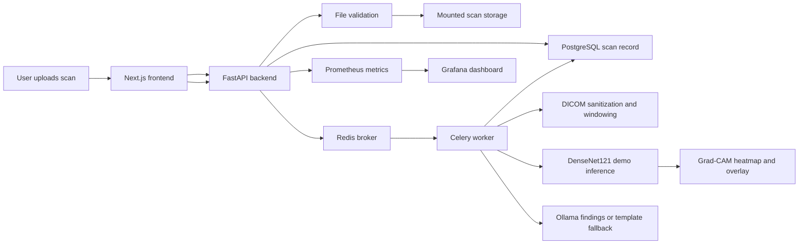
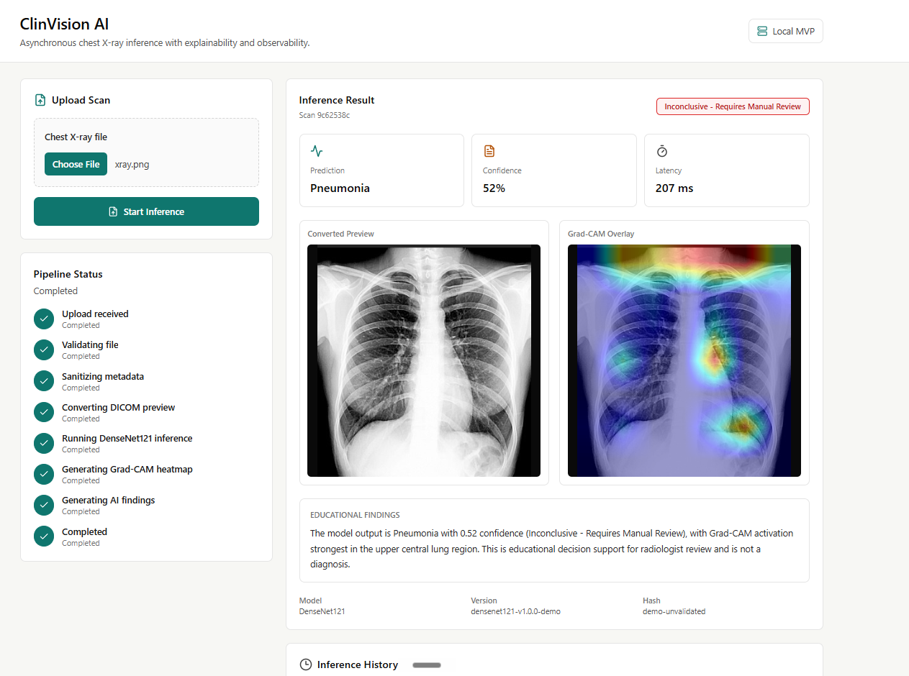
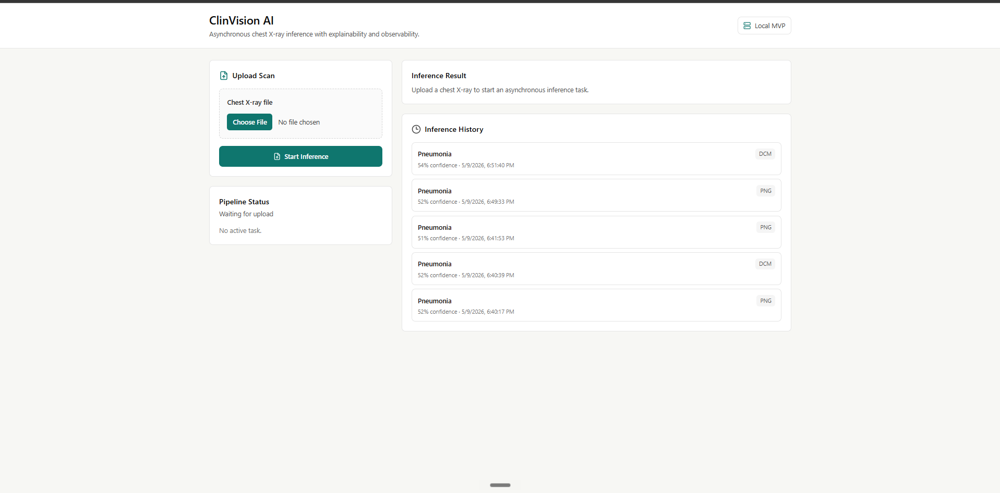

# ClinVision AI

ClinVision AI is an educational medical imaging MVP that demonstrates a production-style asynchronous AI workflow for chest X-ray review. It supports DICOM, JPG, and PNG uploads, processes scans outside the API request path, generates Grad-CAM explainability overlays, writes inference history to PostgreSQL, and exposes Prometheus/Grafana observability.

This project is not clinically validated and is not for diagnosis. The included DenseNet121 configuration is a demo inference path intended to show platform architecture, privacy-aware imaging preprocessing, and operational ML patterns.

## Project Value

- **Asynchronous ML inference:** FastAPI accepts uploads and immediately returns a `task_id`; Celery workers process scans through Redis without blocking API requests.
- **Medical imaging support:** Upload validation handles `.dcm`, `.jpg`, `.jpeg`, and `.png` files, rejecting empty, unsupported, oversized, corrupt, or invalid inputs.
- **DICOM privacy and image quality:** DICOM metadata sanitization removes common patient and institution identifiers, applies VOI LUT/windowing, handles 12-bit and 16-bit pixel data, and normalizes previews to avoid black or white output.
- **DenseNet121 demo inference:** PyTorch and torchvision run a binary Normal vs Pneumonia inference path with backend-owned confidence thresholding.
- **Explainability:** Grad-CAM produces raw heatmaps and overlays aligned to the original image dimensions.
- **LLM-assisted findings:** Ollama can generate concise educational findings, with a deterministic template fallback when Ollama is unavailable.
- **Persistent history:** PostgreSQL stores scan status, paths, predictions, confidence, model metadata, latency, reports, and errors.
- **Observability:** Prometheus metrics and a Grafana dashboard track task counts, failures, latency, confidence distribution, inconclusive rate, and file type breakdown.
- **Containerized deployment:** Docker Compose runs the frontend, backend, worker, Redis, PostgreSQL, Prometheus, and Grafana stack.

## Architecture



## Screenshots

Place final screenshots in `docs/assets`. See [docs/screenshots.md](docs/screenshots.md) for capture guidance.

**Main App Result View**



**Observability Or History View**



## Quick Start

Copy the environment template:

```bash
cp .env.example .env
```

Start the full local stack:

```bash
docker compose up --build
```

Open the services:

- Frontend: [http://localhost:3000](http://localhost:3000)
- Backend API docs: [http://localhost:8000/docs](http://localhost:8000/docs)
- Backend health: [http://localhost:8000/api/health](http://localhost:8000/api/health)
- Prometheus: [http://localhost:9090](http://localhost:9090)
- Grafana: [http://localhost:3001](http://localhost:3001), login `admin` / `admin`

Ollama is optional. If `OLLAMA_BASE_URL` is unavailable, the worker uses template-based educational findings.

## Core API

- `POST /api/scans`
- `GET /api/scans/{task_id}/status`
- `GET /api/scans/result/{scan_id}`
- `GET /api/scans`
- `GET /api/health`
- `GET /api/version`
- `GET /metrics`

`POST /api/scans` returns `scan_id`, `task_id`, and status immediately. Model inference runs only in the worker container.

## Testing And Validation

Run backend tests:

```bash
cd backend
pytest
```

Run the frontend production build:

```bash
cd frontend
npm run build
```

Check production dependency audit:

```bash
cd frontend
npm audit --omit=dev
```

Validate Docker Compose configuration:

```bash
docker compose config --quiet
```

## Observability

The backend exposes Prometheus metrics at `/metrics`, including:

- `http_requests_total`
- `scan_tasks_total`
- `scan_tasks_failed_total`
- `inference_latency_ms`
- `confidence_score_distribution`
- `inconclusive_rate`
- `file_type_count`
- `model_version_info`

Grafana provisions a ClinVision dashboard with panels for average inference latency, completed versus failed tasks, confidence distribution, inconclusive rate, file type breakdown, and recent failures.

## Privacy And Safety

DICOM sanitization removes common sensitive fields before downstream processing, including patient name, patient ID, birth date, sex, address, institution name, referring physician, accession number, study ID, and study/content dates.

LLM prompts receive only prediction, confidence, confidence status, Grad-CAM region summary, model version, and an educational disclaimer. Filenames, patient identifiers, DOB, and hospital metadata are not sent to the LLM or intentionally logged.

## Known Limitations

- The demo DenseNet121 checkpoint/configuration is unvalidated and does not represent clinical performance.
- This project is not for diagnosis, triage, treatment decisions, or patient care.
- The inference task is a binary Normal vs Pneumonia demo only.
- The application is a local single-user MVP with no authentication or multi-tenant authorization.
- The project does not claim HIPAA, FDA, SOC 2, or production medical device compliance.

